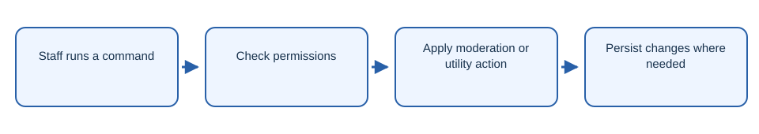

# NeonManage

Minecraft server administration plugin with moderation and utility commands.

## Workflow

1. Staff runs a command.
2. Check permissions.
3. Apply moderation or utility action.
4. Persist changes where needed.

## Getting started

Build with `mvn package` and install the JAR on a compatible Paper server.

## License

The project code is licensed under AGPL-3.0-only. See [LICENSE](LICENSE).
